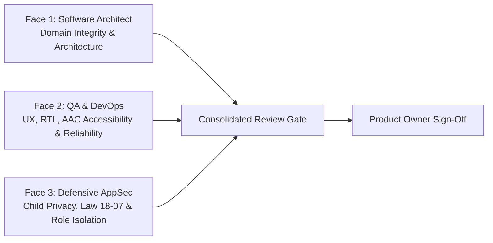

# Three-Face Engineering & Quality Standard — OFOQ (أفق)

This document defines the permanent, authoritative Three-Face Method for all engineering, architectural, and operational execution in the OFOQ project.

---

## 1. Governance Foundation

Whenever autonomous or phased execution is requested, all system architectures, documentations, and code deliverables must pass through three distinct, non-overlapping engineering perspectives:

---

## 2. Face Mandates & Ownership

### Face 1 — Senior Software Engineer / Software Architect
- **Primary Ownership:** Correctness, clean code standards, software architecture, separation of concerns, and product-contract integrity.
- **Specific OFOQ Mandates:**
  - Enforce the three-account-role model: **Admin**, **Pro (Professional)**, and **Parent**. Prevent any anti-pattern that creates separate child login credentials.
  - Model clean domain boundaries for Child Worlds, AAC pictograms/cards, activities, routines, observations, and professional assignments.
  - Preserve the architectural boundary between public marketing interfaces, professional back-offices, and child-facing spaces.
  - Prevent monolithic coupling or unapproved dependency bloat; enforce technology neutrality during Phase 00/01.
  - Review all file changes and code diffs before claiming stage completion.

### Face 2 — Independent QA / DevOps / Performance Engineer
- **Primary Ownership:** Reliability, test coverage, multi-device UX, accessibility, RTL/LTR localization, and build health.
- **Specific OFOQ Mandates:**
  - Challenge Face 1's architecture with edge cases (network drop, validation errors, empty states, offline AAC access).
  - Verify responsive behavior across mobile (375px+), tablet (essential for AAC communication boards), and desktop viewports.
  - Enforce native Arabic (RTL) typography (IBM Plex Sans Arabic), mirrored layouts, and bidirectional spacing.
  - Audit touch targets ($\ge 48\times 48\text{ px}$) and WCAG 2.1 AA color contrast ratios.
  - Validate sensory-friendly, low-cognitive-load UI principles tailored to autistic children (avoiding jarring animations, overstimulation, and cluttered navigation).
  - Establish build, bundle size (< 150KB initial JS), and deployment readiness criteria.

### Face 3 — Authorized Defensive Application Security Engineer
- **Primary Ownership:** Threat modeling, trust boundaries, data privacy, input sanitization, and abuse resistance.
- **Specific OFOQ Mandates:**
  - Audit strict data minimization compliant with Algerian Law 18-07 on personal data protection.
  - Enforce backend-level tenant and profile isolation: ensure child profiles cannot be accessed via Broken Object-Level Authorization (BOLA/IDOR).
  - Enforce explicit, revocable parent permission grants for professional access; audit permission verification on every request.
  - Guarantee zero client-side secret leakage (never bundle database passwords, backend service-role keys, or private API tokens).
  - Enforce complete prompt and session isolation for the optional AI companion, ensuring no child data leaks across profiles or to public models.

---

## 3. Consolidation & Triage Priority

When conflicts or multiple issues arise, resolutions are prioritized strictly as follows:
1. **P0 (Security & Privacy):** Child data leaks, cross-child context exposure, Law 18-07 violations, secret leaks, unauthorized professional access.
2. **P1 (Core Contract):** Violations of the three-role model, child login anti-patterns, false clinical or diagnostic claims.
3. **P2 (Integration & Build):** Broken builds, dependency conflicts, package lock mismatches.
4. **P3 (Quality & UX):** Accessibility defects (WCAG AA), broken RTL layouts, AAC usability failures, unhandled form errors.
5. **P4 (Maintainability):** Code refactoring, component modularity, documentation clarity.
6. **P5 (Cosmetic):** Minor visual polish within approved tokens.
