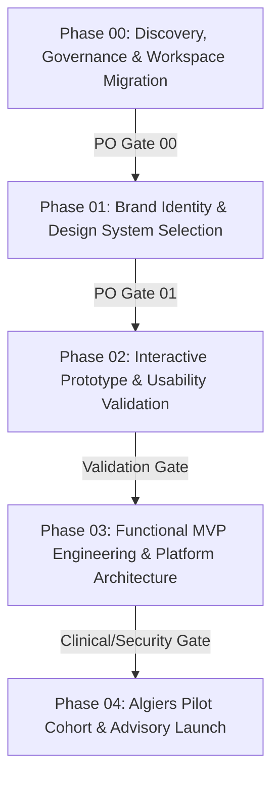

# High-Level Project Roadmap — OFOQ (أفق)

This roadmap outlines the major delivery phases, milestones, and gate criteria for the OFOQ connected digital ecosystem.

---

## Phase Overview

---

## 1. Phase Breakdown

### Phase 00 — Discovery, Governance & Workspace Migration (Current)
- **Objective:** Reconcile product discovery baseline, establish strict engineering governance (`.agent/`), adapt repository documentation, initialize local Git, and isolate inherited scaffolds.
- **Stages:**
  - Gate 0: Repository inspection, baseline verification & Git initialization — `PASSED`
  - Gate 1: Agent governance adaptation (`.agent/*`) — `IN PROGRESS`
  - Gate 2: GitHub workflow templates adaptation (`.github/*`) — `PENDING`
  - Gate 3: Root README migration (`README.md`) — `PENDING`
  - Gate 4: Project foundation documentation (`docs/00-project/*`) — `PENDING`
  - Gate 5: Master product specification (`docs/01-product/product.md`) — `PENDING`
  - Gate 6: QA verification, diff review & local Git commit — `PENDING`
  - Gate 7: Executive Phase 00 report & PO review handoff — `PENDING`
- **Gate Criteria:** Three-Face consensus; clean local Git baseline; formal Product Owner sign-off to exit Phase 00.

### Phase 01 — Brand Identity & Design System Selection (Next)
- **Objective:** Finalize official color palette selection with the Product Owner, define accessibility-audited design tokens, establish typography pairings (IBM Plex Sans Arabic, Manrope, Inter), and build the core component library.
- **Milestones:**
  - Milestone 1.1: Product Owner formal selection of the official color palette from exploratory directions.
  - Milestone 1.2: Design token specification (color, spacing, elevation, radius, typography).
  - Milestone 1.3: Brand identity guidelines (hybrid logo vector assets, iconography, tone of voice).
  - Milestone 1.4: WCAG 2.1 AA contrast audit across all tokens and dark/light modes.
- **Gate Criteria:** Product Owner sign-off on official color palette and design system specification.

### Phase 02 — Interactive Prototype & Usability Validation
- **Objective:** Build an end-to-end interactive Figma prototype demonstrating the core closed-loop ecosystem narrative:
  1. Parent creates a family account and configures two distinct Child Profiles.
  2. Each child receives an independent Child World.
  3. Parent explicitly authorizes a specialist for Child A.
  4. Specialist views only Child A and assigns an activity/vocabulary card.
  5. Parent contributes home vocabulary and routine.
  6. Child enters Child World A and uses an AAC communication card.
  7. Activity event is logged; parent and specialist review progress history.
- **Milestones:**
  - Milestone 2.1: Information architecture and screen inventory (Web & Mobile).
  - Milestone 2.2: Clickable Figma prototype across Parent, Child, Pro, and Admin flows.
  - Milestone 2.3: Usability testing protocol with Algerian families and speech therapists/educators.
- **Gate Criteria:** Usability benchmarks met; parent understanding of Child World switching validated; zero confusion on professional access boundaries.

### Phase 03 — Functional MVP Engineering & Platform Architecture
- **Objective:** Build and deploy the production-ready MVP platform: modular backend API, PostgreSQL relational database, web administration/specialist portal, and parent/child mobile application.
- **Milestones:**
  - Milestone 3.1: Backend architecture, IAM, role-based access control (Admin, Pro, Parent).
  - Milestone 3.2: Multi-child data model, Child World tenant isolation, permission grant service.
  - Milestone 3.3: AAC engine, communication card asset pipeline, and audio synthesis.
  - Milestone 3.4: Web application for specialists and administrators.
  - Milestone 3.5: Mobile application for family management and Child World mode.
  - Milestone 3.6: Algerian Law 18-07 privacy audit, penetration testing, and zero-trust verification.
- **Gate Criteria:** Three-Face sign-off; independent security audit passed; zero P0/P1 defects.

### Phase 04 — Algiers Pilot Cohort & Advisory Launch
- **Objective:** Execute a supervised pilot cohort in Algiers with selected families and licensed specialists.
- **Milestones:**
  - Milestone 4.1: Onboarding of initial pilot families and verified specialists.
  - Milestone 4.2: Structured feedback collection and advisory board reviews.
  - Milestone 4.3: Performance, reliability, and security monitoring under live load.
- **Gate Criteria:** Pilot satisfaction targets achieved; formal clinical/advisory approval for expanded regional rollout.
