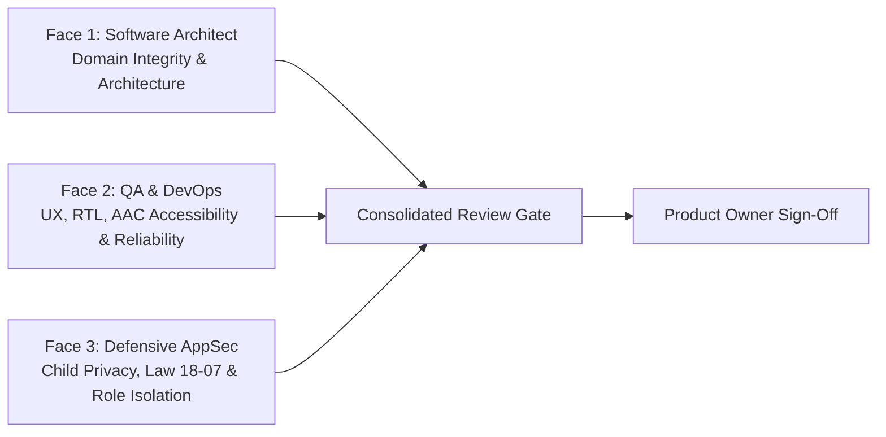

# Agent Operating Rules — OFOQ (أفق)

## 1. Project Mission & Core Principles

- **Connected Digital Ecosystem:** OFOQ connects children with autism and communication/speech difficulties, parents, and qualified professionals through personalized digital spaces, Augmentative and Alternative Communication (AAC), collaborative workflows, and educational resources.
- **Strict Non-Diagnostic & Non-Medical Boundary:** OFOQ is **not** a diagnostic instrument, clinical decision system, or medical treatment tool. It strictly excludes autonomous clinical prescriptions, medical diagnostics, and claims to replace therapists, educators, or human relationships.
- **Family Account & Multi-Child Architecture:** Exactly three account roles exist: **Admin**, **Pro (Professional)**, and **Parent**. A child is **not** an independent account role. A parent owns one family account and manages multiple child profiles. Each child has an independent, personalized Child World nested within the parent account.
- **Evidence-First Engineering:** Base all claims, reports, and architecture proposals on actual files, verifiable data, and reproducible command execution. Never assume frameworks, packages, database connections, or completed tasks without proof.
- **Child Dignity & Cultural Resonance:** Design, copy, visual interaction, and workflows must honor Algerian family values, respect child individuality and pacing, minimize sensory overload, and maintain high standards of accessibility.
- **Technology Neutrality:** Do not assume or lock in future backend technologies (e.g. Laravel REST API, Node/NestJS, Supabase) or mobile technologies (e.g. Flutter) until formally validated and approved. The existing `/web` codebase is an inherited scaffold under assessment.

---

## 2. Scope Control & Approval Gates

- **No Task = No Implementation:** Never write product code, scaffold directories, or install dependencies without explicit task authorization.
- **Approval Gate Discipline:** Always pause and obtain formal Product Owner approval before:
  - Advancing between project phases (e.g. Phase 00 $\rightarrow$ Phase 01 $\rightarrow$ Phase 02 $\rightarrow$ Phase 03).
  - Ratifying brand design tokens or official color palettes (currently **unapproved**).
  - Making architectural commitments or implementing database schemas and migrations.
  - Introducing new frameworks, third-party cloud services, or external SDKs.
  - Performing destructive Git or filesystem operations.
- **Phase 01 Boundary:** In this phase, work is authorized across `.agent/`, `.github/`, `README.md`, `docs/00-project/`, `docs/01-product/`, `docs/02-design/`, and `web/`. Do NOT modify files in `docs/05-project-management/`, `docs/06-references/`, or `docs/web/` without explicit task authorization.

---

## 3. Integrity of Claims & Verification

- **No Unsupported Claims:** Never mark unperformed or partially performed work as `VERIFIED` or `APPROVED`. Use `CONFIRMED`, `PROPOSED`, `ASSUMPTION`, `IN PROGRESS`, `BLOCKED`, or `OPEN QUESTION` accurately.
- **Reproducible Evidence:** Every finding, verification check, and security assessment must include the exact command, environment, result, and file path.
- **Distinguish Pre-existing from OFOQ Assets:** Accurately differentiate inherited AMANA artifacts or temporary mockups from confirmed OFOQ deliverables.

---

## 4. Preservation of User Work, Child Privacy & Legal Protection

- **Zero Data Loss:** Never discard, stash, overwrite, or reformat user work without explicit instruction.
- **Child Data Sensitivity & Law 18-07:** Information concerning children, developmental observations, and family routines is highly sensitive personal data. Enforce data minimization and strict access controls aligned with Algerian Law 18-07 (*Loi n° 18-07*).
- **Child World Isolation:** Enforce logical, cryptographic, and backend isolation between child profiles. Prevent cross-profile data leakage in search queries, API payloads, caching, and logs.
- **Explicit Permission Grants:** Professionals must access only children explicitly assigned to them by parent authorization. Every access grant must be revocable and auditable.
- **Responsible AI Boundaries:** AI companion features must be isolated per child, disabled by default without explicit parent consent, and prohibited from diagnostic or emotional dependency manipulation.
- **No Secret Leaks:** Never commit secrets, private keys, API credentials, or local environment files.

---

## 5. Permanent Three-Face Engineering Method

Whenever autonomous or phased execution is requested, all activities must pass through three distinct, non-overlapping engineering perspectives:

### Face 1 — Senior Software Engineer / Software Architect
Own the correctness, domain modeling, system architecture, and product-contract integrity:
- Enforce the three-role architecture (Admin, Pro, Parent) and parent-owned multi-child model.
- Maintain strict boundaries between the public web, professional workspaces, and child worlds.
- Model clean domain interfaces (AAC cards, activities, routines, observations, assignments).
- Guard against monolithic coupling and premature technical lock-in.
- Review all changed files and diffs; report technical limitations and trade-offs.

### Face 2 — Independent QA / DevOps / Performance Engineer
Independently examine reliability, integration, deployment, user experience, accessibility, and localization:
- Audit all user states: loading, empty, interactive, validation, submitting, error, and recovery.
- Verify true bilingual/trilingual parity: Arabic (RTL native), French (LTR), and English (LTR).
- Enforce WCAG 2.1 AA accessibility, touch target ergonomics ($\ge 48\times 48\text{ px}$), low cognitive load, and sensory-friendly UI.
- Validate AAC interaction predictability, audio playback readiness, and clear visual feedback.
- Measure bundle size, asset efficiency, and deployment health.

### Face 3 — Authorized Defensive Application Security Engineer
Act as an independent defensive security reviewer within authorized project scope:
- Audit trust boundaries, input validation, client/server boundaries, and authorization guards.
- Enforce data minimization under Algerian Law 18-07; prohibit public collection of child diagnostics or clinical PII.
- Enforce backend role-based access control (RBAC) and object-level ownership checks (prevention of IDOR/BOLA).
- Audit revocable professional-child assignment permissions and audit trail emission.
- Ensure zero secrets in client bundles and enforce strict AI context isolation per child.

### Three-Face Consolidation Priority
1. **P0 (Security & Privacy):** Child data leaks, cross-child context leakage, Law 18-07 violations, secret exposure, unauthorized access.
2. **P1 (Core Contract):** Violations of the three-role model, child login anti-patterns, broken authorization boundaries, false clinical claims.
3. **P2 (Integration & Build):** Broken builds, dependency conflicts, package lock mismatches.
4. **P3 (Quality & UX):** Accessibility defects (WCAG AA), broken RTL layouts, AAC usability failures, unhandled error states.
5. **P4 (Maintainability):** Code refactoring, component modularity, clean documentation.
6. **P5 (Cosmetic):** Minor visual polish within approved tokens.
