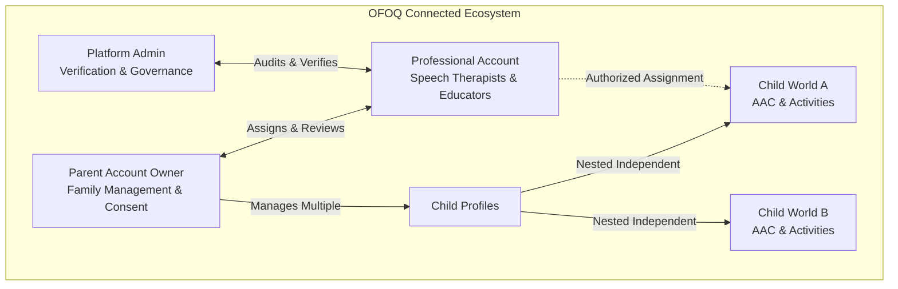

# Product Specification & PRD — OFOQ (أفق)

**Document Identifier:** `DOC-01-PRODUCT`  
**Version:** 1.0.0 (OFOQ Baseline from `OFOQ_PROJECT_DISCOVERY.md`)  
**Primary Language:** English (System & Architecture) • Arabic & French (Domain Copy & Personas)  
**Audience:** Founders, Product Managers, System Architects, UX Leads, Clinical Advisors  
**Last Updated:** November 23, 2026  
**Status:** `CONFIRMED DISCOVERY BASELINE — PENDING PHASE 00 RATIFICATION`  

---

## 1. Product Identity

| Attribute | Specification |
| :--- | :--- |
| **Product Name** | **OFOQ (أفق)** |
| **Brand Tagline** | *« لكل طفل أفقه الخاص »* • *"Every child has their own horizon."* • *« Chaque enfant a son propre horizon. »* |
| **Product Category** | Connected Pediatric Digital Ecosystem (AAC, Child Workspaces & Care Coordination) |
| **Target Market** | Algeria (National rollout across major wilayas) |
| **Business Model** | Dual-Sided Platform: B2C (Family Subscriptions) & B2B (Specialists & Center Subscriptions) |
| **Current Maturity** | Phase 00 (Discovery Baseline & Workspace Governance Migration) |
| **Service Character** | Communication enablement, family coordination, and non-diagnostic educational support |
| **Brand Identity Status** | Logo Concept: **Hybrid** (Approved) • Tone: **Balanced** (Approved) • Colors: **Unapproved (Pending PO Choice)** |

---

## 2. Problem Statement & Algerian Context

In Algeria, families raising children with autism or speech/communication difficulties face structural challenges:

1. **The Continuity Gap:** Specialized therapy sessions (speech therapy / *orthophonie*, psychomotor therapy, special education) are typically restricted to 1–2 hours weekly. Families lack structured, practical tools to continue communication practice and developmental routines at home.
2. **Lack of Localized AAC Resources:** Available Augmentative and Alternative Communication (AAC) software is imported from abroad, expensive, foreign-currency gated, and lacks Modern Standard Arabic and Algerian Arabic (Derja) vocabulary or cultural resonance.
3. **Professional Overload & Coordination Friction:** Therapists lack dedicated digital platforms to assign home targets, review parent observations, and coordinate without sacrificing their personal boundaries on consumer messaging apps.
4. **Parental Isolation:** Parents often navigate complex developmental challenges without structured guidance, shared family tracking, or validated pedagogical content.

---

## 3. Vision, Mission & Strategic Principles

### 3.1 Product Vision
To build the definitive North African digital ecosystem where every child with communication difficulties flourishes in their own personalized space, families feel empowered and in control, and professionals collaborate seamlessly to provide continuous, dignified support.

### 3.2 Product Mission
To dismantle communication barriers for children with autism and speech delays by unifying symbol-based AAC, personalized child workspaces, parent-specialist collaboration, and validated educational resources within an accessible, culturally grounded Algerian platform.

### 3.3 Core Strategic Principles
- **One Family, Multiple Horizons:** One parent account seamlessly houses independent, isolated Child Worlds for each child in the family.
- **Dignity & Individual Pace:** Respect the child’s cognitive pace, sensory sensitivities, and privacy.
- **Ecosystem Bridge:** Bridge clinic and home; empower parents as active partners rather than passive bystanders.
- **Traceable Content Provenance:** Explicitly distinguish professional plans, parent contributions, and AI suggestions.

---

## 4. Product Positioning & Non-Diagnostic Boundary

```text
+------------------------------------+------------------------------------+
| WHAT OFOQ IS                       | WHAT OFOQ IS NOT                   |
+------------------------------------+------------------------------------+
| • A connected digital ecosystem    | • A diagnostic or screening tool   |
| • An AAC communication platform    | • An automated clinical therapy    |
| • A parent-pro collaboration tool  | • A replacement for therapists     |
| • A structured educational hub     | • A social network for children    |
| • A controlled assistive assistant | • An autonomous clinical decision  |
|                                    |   system or medical device         |
+------------------------------------+------------------------------------+
```

> **Strict Non-Diagnostic Boundary:** OFOQ does not score autism severity, evaluate developmental pathology, or issue diagnostic determinations. It strictly leaves diagnosis and clinical treatment prescriptions to qualified medical and allied-health professionals.

---

## 5. Market Scope & Dual Business Model (B2C & B2B)

OFOQ operates a two-sided ecosystem tailored to the Algerian domestic economy:

1. **B2C (Families & Parents):**
   - Free foundational access to core AAC communication cards and daily routine scheduling.
   - Proposed premium family subscription (hypothesized at 1,500 DZD/month or 12,000 DZD/year) unlocking multiple child worlds, cloud backup, audio synthesis, and OFOQ Academy masterclasses.
2. **B2B (Practitioners & Centers):**
   - Professional tier for independent speech therapists (*orthophonistes*), psychomotor therapists, and educators (hypothesized at 5,000 DZD/month).
   - Institutional center tier for multi-practitioner clinics, associations, and specialized schools.
   - *Financial Discipline Note:* All pricing tiers are unvalidated hypotheses requiring empirical market testing during Phase 01/02.

---

## 6. User Personas & Stakeholder Ecosystem



### 6.1 Persona 1: The Dedicated Parent (Amina M.)
- **Profile:** 34 years old, mother of two living in Bab Ezzouar (Algiers).
- **Situation:** Her 5-year-old son, Yanis, is on the autism spectrum with minimal verbal output; her 8-year-old daughter, Maya, has mild articulation difficulties.
- **Pain Point:** Exhausted from carrying heavy paper PECS binders; struggles to remember which vocabulary words Yanis practiced with his speech therapist; needs one place to track both children without logging in and out.
- **Key Need:** Single mobile app where she can toggle between Yanis’s visual AAC world and Maya’s speech exercises, while receiving clear weekly targets from their speech therapist.

### 6.2 Persona 2: The Autistic Child (Yanis M.)
- **Profile:** 5 years old, minimally verbal, loves trains, highly visual, sensitive to loud unexpected noises.
- **Pain Point:** Frustrated when unable to express thirst, fatigue, or sensory overload; easily overwhelmed by cluttered tablet screens.
- **Key Need:** A calm, high-contrast, predictable Child World with clear pictograms that speak words clearly in Arabic when tapped, allowing him to express his immediate needs effortlessly.

### 6.3 Persona 3: The Speech-Language Therapist (Karim B.)
- **Profile:** 38 years old, licensed private speech therapist (*orthophoniste*) in Kouba (Algiers), managing 25 pediatric patients.
- **Pain Point:** Spends unpaid evening hours answering fragmented WhatsApp voice notes from anxious parents; has zero visibility into whether home exercises were actually practiced.
- **Key Need:** Professional web dashboard where he can view assigned child profiles, assign custom vocabulary cards with one click, and log quick session observations that parents can read and implement.

### 6.4 Persona 4: The Platform Administrator (Dr. Leila H.)
- **Profile:** Platform clinical coordinator and administrative governance lead.
- **Responsibilities:** Verifies practitioner diplomas and state licenses, moderates shared community AAC card submissions, oversees platform security, and reviews data privacy audits.

---

## 7. Account Roles & Identity Architecture

OFOQ enforces exactly **three platform account roles**:

1. **`Admin` (Platform Governance):**
   - User administration, professional credential vetting, and verification.
   - Shared library moderation (AAC symbols, academy courses).
   - Security audit review, Law 18-07 compliance monitoring, and telemetry.
2. **`Pro` (Professional / Specialist):**
   - Manages *only* children explicitly assigned via parent authorization.
   - Assigns activities, communication goals, and vocabulary cards.
   - Logs session observations and prepares progress handover notes.
   - Access is revocable by parents at any time.
3. **`Parent` (Family Account Owner):**
   - Owns the family billing and master account.
   - Creates, edits, and manages one or more Child Profiles.
   - Controls all professional authorization grants and permissions.
   - Contributes home vocabulary and personal child preferences.
   - Switches between child worlds within the authenticated session.

> **Child Account Rule:** A child is **NOT** an independent authentication role. Children access their personalized Child World through their parent's account. No child passwords, email accounts, or separate credentials exist.

---

## 8. The Child World Concept & Multi-Child Architecture

```text
Family Account (Parent: Amina M.)
│
├── Child Profile 1: Yanis (Age 5 - Non-verbal / Autism)
│   └── Child World 1: High-contrast AAC board (2x2 grid), train theme, Pro: Karim B. (Assigned)
│
└── Child Profile 2: Maya (Age 8 - Speech articulation delay)
    └── Child World 2: Standard vocabulary board (4x4 grid), nature theme, Pro: None (Parent-led)
```

- **Independent Personalized Workspaces:** Each Child World retains its own visual theme, pictogram vocabulary, audio recordings, daily routine schedules, activity queues, and progress event logs.
- **Seamless Parent Switching:** The parent switches between child worlds via a top-level profile switcher without re-authenticating.
- **Backend Data Isolation:** Child Worlds are logically and cryptographically partitioned. Visual switching on the client is backed by strict database authorization queries preventing cross-profile data leakage.

---

## 9. The Six Functional Product Pillars

### 9.1 Pillar 1: Augmentative & Alternative Communication (AAC)
- **High-Clarity Pictogram Boards:** Visual grid representing core concepts (Needs, Feelings, Food, People, Actions, Places).
- **Localized Audio Speech Synthesis:** Clear pronunciation in Modern Standard Arabic (MSA) and French, with support for recorded Algerian Arabic (Derja) voice clips.
- **Custom Card Pipeline:** Capability for parents and professionals to upload real photographs of familiar domestic objects, family members, and local school environments.
- **Sentence Construction Bar:** Visual strip where tapping cards sequentially forms a complete expressive phrase (e.g. *« Je veux »* + *« boire »* + *« eau »* / *« أنا أريد »* + *« أشرب »* + *« ماء »*).

### 9.2 Pillar 2: Personalized Child Worlds
- **Sensory-Conscious UI:** Calming color palettes, predictable layouts, zero jarring popups, and configurable card grid densities ($2\times 2$, $3\times 3$, $4\times 4$).
- **Visual Schedules & Daily Routines:** Chronological visual timelines depicting daily events (Morning routine, school, therapy session, snack, bedtime) with completion checkmarks.
- **Child World Security:** Optional parent-lock PIN preventing the child from exiting their Child World into administrative parent settings.

### 9.3 Pillar 3: Family Management & Parent Contributions
- **Centralized Family Hub:** Manage multiple children, emergency contacts, authorized caregivers, and billing under one family subscription.
- **Home Vocabulary Contributions:** Parents introduce familiar colloquial terms, pet names, and family photos directly into the child's AAC board.
- **Progress Tracking:** Timeline of completed activities, communication frequency, and therapist observation notes.

### 9.4 Pillar 4: Professional Collaboration & Permission Grants
- **Permission-Governed Pairing:** A professional enters a secure pairing code generated by the parent or sends an invite link; access requires explicit parental confirmation.
- **Granular Access Control:** Parents choose specific permissions:
  - `PERM_READ_PROGRESS`: View communication event history.
  - `PERM_ASSIGN_ACTIVITIES`: Assign therapy exercises and home routines.
  - `PERM_EDIT_AAC`: Add or customize clinical pictograms and vocabulary.
- **Observation Notes:** Professionals log clinical observations following sessions, creating a shared history that informs home practice.

### 9.5 Pillar 5: Responsible AI Assistance & Safety Boundaries
- **Assistive Scope Only:** AI assists with suggesting personalized vocabulary themes based on child interests or structuring routine schedules.
- **Optional Child Companion:** A conversational avatar that provides gentle encouragement and structured speech practice.
- **Mandatory Safety Safeguards:**
  - Strict parent activation (disabled by default).
  - Complete prompt and session context isolation per child.
  - Strict non-diagnostic, non-clinical prompt boundaries.
  - Zero training of public models on child audio or personal data.

### 9.6 Pillar 6: OFOQ Academy
- **Curated Knowledge Base:** Articles, practical videos, and guides on autism support, speech development, sensory management, and AAC strategies.
- **Dual Tracks:**
  - *Parent Track:* Practical daily life strategies, understanding child sensory signals, communication games.
  - *Professional Track:* Clinical methodology, AAC assessment frameworks, evidence-based practices.
- **Advisory Vetting:** All Academy content reviewed by qualified pedagogical/clinical advisors.

---

## 10. Platform Administration & Trust Operations

- **Practitioner Credential Verification:** Automated workflow where clinicians submit their professional license, diploma, and national ID; administrative staff verify authenticity before conferring the `Verified Pro` badge.
- **Shared Content Moderation:** Admin queue for reviewing community-submitted AAC pictogram sets and public Academy articles.
- **Security & Privacy Audit Console:** Real-time visibility into access anomalies, mass exports, and failed authorization attempts.

---

## 11. End-to-End Core User Journey

```mermaid
sequenceDiagram
    autonumber
    actor Par as Parent (Amina)
    actor Pro as Speech Therapist (Karim)
    actor Chd as Child (Yanis)
    actor Sys as OFOQ Platform

    Par->>Sys: Registers Family Account & Creates Child Profile (Yanis)
    Sys-->>Par: Provisions Child World 1 & Generates Pairing Code
    Par->>Pro: Shares Pairing Code with Speech Therapist
    Pro->>Sys: Requests Access with Pairing Code
    Sys-->>Par: Prompts for Explicit Permission Authorization
    Par->>Sys: Approves Pro Assignment with Granular Permissions
    Pro->>Sys: Assigns 3 AAC Vocabulary Cards (Snack & Juice) & 1 Home Routine
    Sys-->>Par: Notifies Parent of New Assigned Activities
    Par->>Chd: Launches Child World 1 in Child Mode
    Chd->>Sys: Taps "Juice" Communication Card on Tablet
    Sys-->>Chd: Plays Clear Audio Pronunciation in Arabic
    Sys->>Sys: Records Progress Event (AAC Interaction)
    Pro->>Sys: Views Activity Completion in Web Portal & Logs Observation Note
    Par->>Sys: Reviews Therapist Note in Family Progress Feed
```

---

## 12. Multi-Channel Experience Strategy

- **Mobile Application (iOS / Android / Tablet):**
  - Primary interface for daily family life and child interaction.
  - High-performance, offline-resilient AAC grid engine.
  - Touch-optimized child interaction mode with sensory safeguards.
  - Responsive layout optimized for smartphones and 10-inch tablets.
- **Web Application (Desktop & Responsive Tablet):**
  - Optimized for professional therapy practices and clinical cabinets.
  - Comprehensive multi-child management, observation authoring, and report generation.
  - Administrative back-office for credential vetting and content management.
- **Inherited Scaffold Status:** The pre-existing React/Vite codebase in `/web` is an inherited scaffold under assessment; its production suitability will be determined during Phase 03.

---

## 13. Product Scope Matrix

```text
+------------------------+------------------------+------------------------+
| PHASE 02: PROTOTYPE    | PHASE 03: FUNCTIONAL   | FUTURE EXPANSION       |
| (Interactive Figma)    | MVP (Algiers Launch)   | (Post-MVP Horizons)    |
+------------------------+------------------------+------------------------+
| • 16–20 clickable      | • Production Auth &    | • Institutional Clinic |
|   screens              |   Role-Based RBAC      |   Enterprise Dashboard |
| • Parent family setup  | • Multi-Child tenant   | • Advanced Conversational|
|   & child world switch |   database isolation   |   AI Child Companion   |
| • Pro assignment grant | • Core AAC Grid Engine | • School / Classroom   |
| • AAC board simulation |   with audio synthesis |   Integration Mode     |
| • Activity assignment  | • Pro portal & Parent  | • Multilingual Voice   |
| • Fictional data only  |   mobile application   |   Cloning for Family   |
| • Zero live backend    | • Algerian Law 18-07   | • Wearable Sensory Sync|
| • Brand concept demo   |   privacy controls     | • Expansion to Oran &  |
|                        | • Domestic payments    |   Constantine Wilayas  |
+------------------------+------------------------+------------------------+
```

---

## 14. Traceable Functional Requirements Matrix (PRD)

| Requirement ID | Module | Actor | Description | Priority | Dependencies | Status |
| :--- | :--- | :--- | :--- | :---: | :--- | :--- |
| **`PROD-001`** | **IAM / Accounts** | Parent | Register family account via email/phone and affirmative consent checkbox. | P0 | None | `CONFIRMED` |
| **`PROD-002`** | **IAM / Accounts** | Parent | Create and manage multiple Child Profiles under single family account. | P0 | `PROD-001` | `CONFIRMED` |
| **`PROD-003`** | **Child World** | Parent/Child | Switch between independent Child Worlds without re-authentication. | P0 | `PROD-002` | `CONFIRMED` |
| **`PROD-004`** | **Child World** | Child | Interact with personalized Child World with sensory-friendly visuals. | P0 | `PROD-003` | `CONFIRMED` |
| **`PROD-005`** | **AAC Engine** | Child | Display categorized pictogram grids ($2\times 2$ to $4\times 4$) with text labels. | P0 | `PROD-004` | `CONFIRMED` |
| **`PROD-006`** | **AAC Engine** | Child | Play clear audio pronunciation upon tapping communication card (MSA/French). | P0 | `PROD-005` | `CONFIRMED` |
| **`PROD-007`** | **AAC Engine** | Parent/Pro | Upload custom photographic cards with recorded voice clips. | P1 | `PROD-005` | `PROPOSED` |
| **`PROD-008`** | **Collaboration** | Parent | Generate secure pairing code to invite licensed professional. | P0 | `PROD-002` | `CONFIRMED` |
| **`PROD-009`** | **Collaboration** | Parent | Authorize or instantly revoke granular professional permissions. | P0 | `PROD-008` | `CONFIRMED` |
| **`PROD-010`** | **Collaboration** | Professional| Web dashboard displaying only explicitly assigned children. | P0 | `PROD-009` | `CONFIRMED` |
| **`PROD-011`** | **Collaboration** | Professional| Assign targeted developmental activities and routine targets to child world. | P0 | `PROD-010` | `CONFIRMED` |
| **`PROD-012`** | **Observations** | Professional| Author structured session observations visible to authorized parents. | P1 | `PROD-010` | `CONFIRMED` |
| **`PROD-013`** | **Telemetry** | System | Log completed activities and AAC interactions as chronological progress events. | P1 | `PROD-006` | `CONFIRMED` |
| **`PROD-014`** | **OFOQ Academy** | Parent/Pro | Browse curated educational articles and video guides on autism and AAC. | P2 | None | `PROPOSED` |
| **`PROD-015`** | **Admin Ops** | Admin | Review uploaded professional credentials and confer `Verified Pro` status. | P0 | None | `CONFIRMED` |
| **`PROD-016`** | **Privacy/Audit** | Admin/Parent| Maintain append-only audit trail for permission changes and data access. | P0 | `PROD-009` | `CONFIRMED` |
| **`PROD-017`** | **AI Safety** | Parent | Enable optional AI companion with isolated context and parental kill-switch. | P2 | `PROD-004` | `PROPOSED` |
| **`PROD-018`** | **Offline AAC** | Child | Access cached core communication cards without active internet connection. | P1 | `PROD-005` | `PROPOSED` |

---

## 15. Non-Functional & Security Requirements

- **NF-SEC-01 (Law 18-07 Privacy):** Enforce strict data minimization; zero child clinical PII exposed on public forms.
- **NF-SEC-02 (Object-Level Authorization):** Backend API must enforce tenant ownership checks on every request, completely preventing Insecure Direct Object References (BOLA/IDOR).
- **NF-SEC-03 (Zero Secret Leakage):** Absolute prohibition against bundling private API keys, database credentials, or service tokens in client bundles.
- **NF-PERF-01 (AAC Responsiveness):** Audio playback and visual card expansion must execute in $< 50\text{ ms}$ upon tap to preserve tactile-vocal feedback.
- **NF-PERF-02 (Bundle Size):** Initial web bundle $\le 150\text{ KB}$ gzipped; mobile app startup time $\le 1.5\text{ s}$.
- **NF-REL-01 (Offline Resilience):** Critical AAC communication grids must function reliably in offline flight mode.

---

## 16. Accessibility & Localization Standards

- **WCAG 2.1 AA Compliance:** Minimum color contrast of $4.5:1$ for body text and $3.0:1$ for visual boundaries.
- **Sensory Ergonomics:** Autism-conscious design; soft transitions ($< 200\text{ ms}$); no strobing animations; clear visual containers.
- **Touch Target Sizing:** Minimum $48 \times 48\text{ px}$ on smartphones; minimum $64 \times 64\text{ px}$ on tablet AAC grids.
- **Bilingual / RTL Mirroring:** First-class native Arabic (RTL) typography powered by **IBM Plex Sans Arabic**, paired with French and English (LTR).

---

## 17. Commercial & Business Model Hypotheses

*The following financial assumptions are preserved strictly for discovery and validation:*
- **B2C Family Tier:** 1,500 DZD/month (or 12,000 DZD/year) unlocking multi-child worlds, custom photo upload, and cloud sync.
- **B2B Professional Tier:** 5,000 DZD/month unlocking multi-child caseload management and shared observation tools.
- **Payment Gateway:** Domestic clearing via Edahabia (Algérie Poste), CIB cards, and BaridiMob.

---

## 18. Success Metrics & Validation Benchmarks

### 18.1 Phase 02 Prototype Usability Benchmarks
- **Child World Comprehension:** $\ge 80\%$ (4/5 test parents) grasp the concept of multiple independent Child Worlds under one account within 60 seconds.
- **AAC Usability:** $\ge 80\%$ of test children/parents successfully execute a 3-card communication phrase within 2 minutes.
- **Permission Clarity:** $100\%$ of test parents correctly identify how to revoke a professional's access.

### 18.2 Phase 03/04 Operational MVP Benchmarks
- **Daily Active AAC Sessions:** Average $\ge 5$ communication sessions per active child profile daily.
- **Therapist Retention:** $> 75\%$ active practitioner engagement month-over-month.
- **Parent Net Promoter Score (NPS):** $\ge 60$ among participating Algerian pilot families.

---

## 19. Dependencies, Key Risks & Mitigations

1. **Brand Design Color Ratification:** The official brand color palette remains unapproved. *Mitigation:* Explicit PO gate in Phase 01 before design system build.
2. **Clinical Advisory Alignment:** Risk of misinterpreting speech therapy methodologies. *Mitigation:* Establish formal Clinical Advisory Committee before Phase 02 prototype testing.
3. **Regulatory Authorization (ANPDP):** Risk of cross-border data transfer restrictions under Law 18-07. *Mitigation:* Legal review of hybrid hosting architecture prior to MVP deployment.

---

## 20. Traceability & Cross-References
- Primary Baseline: [`docs/00-project/OFOQ_PROJECT_DISCOVERY.md`](../docs/00-project/OFOQ_PROJECT_DISCOVERY.md)
- Decision Log: [`docs/00-project/decision-log.md`](../docs/00-project/decision-log.md)
- Open Questions Tracker: [`docs/00-project/open-questions.md`](../docs/00-project/open-questions.md)
- Governance Rules: [`.agent/RULES.md`](../../.agent/RULES.md)
