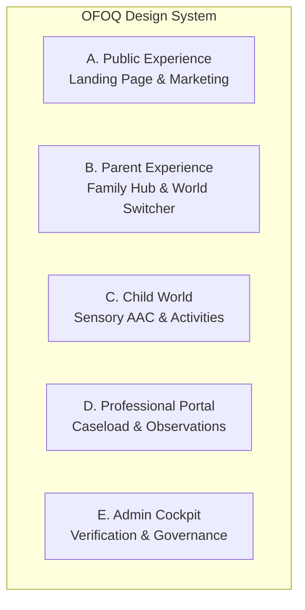

# OFOQ Design System & Experience Architecture

**Document Identifier:** `DOC-02-DESIGN`  
**Version:** 2.0.0 (OFOQ Phase 01 Ratification)  
**Primary Language:** English (Specifications) • Arabic & French (UI Copy & Typography)  
**Audience:** Brand Designers, UI/UX Designers, Design Systems Architects, Frontend Engineers  
**Last Updated:** November 23, 2026  
**Status:** `CONFIRMED DESIGN SYSTEM BASELINE — PHASE 01`  

---

## 1. Brand Strategy & Visual Philosophy

**OFOQ (أفق)** is an Algerian digital ecosystem supporting autistic children and children experiencing communication and speech difficulties, their parents, and professionals.

Its visual identity expresses five core emotional tenets:

| Principle | Meaning & Emotional Intent | Visual Expression |
| :--- | :--- | :--- |
| **Trust & Care** | Reassuring families and clinicians that child data and progress are safe. | Deep Midnight Navy foundations, crisp typography, clean borders. |
| **Dignity & Respect** | Honoring the child's individual pace without condescension or childish stereotypes. | High-quality vector iconography, thoughtful spacing, mature color balance. |
| **Imaginative Horizon** | Inspiring optimism and potential (*« لكل طفل أفقه الخاص »*). | Celestial and horizon motifs, subtle cosmic depth, soft glow accents. |
| **Calm Sensory Balance** | Eliminating sensory overload for neurodivergent children. | Low-saturation backgrounds, gentle motion, soft glassmorphic depth. |
| **Seamless Connection** | Visually linking the family, the specialist, and the child's unique world. | Interlocking circular arcs, shared progress cards, clear provenance tags. |

> **Aesthetic Boundary:** OFOQ is neither a cold, sterile hospital portal nor a chaotic, overstimulating cartoon game. It is a modern, premium digital ecosystem combining clinical credibility with empathetic domestic warmth.

---

## 2. Refined Brand Color Palette

The Product Owner has formally approved the authoritative **OFOQ Refined Brand Color Palette**. It consists of five core brand colors anchored on a neutral porcelain canvas:

```text
+---------------------------------------------------------------------------------+
|  OFOQ REFINED BRAND COLOR PALETTE                                               |
+---------------------------------------------------------------------------------+
|  #172B46  Midnight Navy        Primary: Trust, professionalism & identity       |
|  #2868C7  Royal Horizon Blue   Secondary: Hope, communication & technology      |
|  #A9C5D8  Cloud Blue           Supporting: Calm, accessibility & comfort        |
|  #D8BE83  Soft Gold            Accent: Growth, achievement & optimism           |
|  #D58C7A  Muted Coral          Human Accent: Warmth, empathy & family connection|
|  #F5F6F3  Porcelain            Neutral Foundation: Gentle light canvas          |
+---------------------------------------------------------------------------------+
```

### 2.1 Color Roles & Visual Weight Distribution

To maintain a serene, premium atmosphere, the palette is applied with intentional hierarchy:

```text
[ Porcelain (55% Canvas) ] ────────────── Global light background, glare-free breathing space
[ Midnight Navy (20% Structure) ] ─────── Primary navigation, bold headings, dark anchor surfaces
[ Royal Horizon Blue (12% Energy) ] ──── Primary actions, luminous gradients, 3D planet halos
[ Cloud Blue (8% Calming Depth) ] ────── Translucent glass panels, calm secondary surfaces
[ Muted Coral (3% Human Spark) ] ─────── Human empathy highlights, AAC tactile feedback
[ Soft Gold (2% Celestial Wonder) ] ──── Achievement stars, routine badges, Spacetoon planet rings
```

### 2.2 Complete Color Matrix & Derived Tones

To satisfy WCAG 2.1 AA accessibility and provide robust UI states, the five core colors are extended into derived functional tones:

| Token | Hex Value | Role / Usage | Contrast Ratio vs Porcelain (`#F5F6F3`) |
| :--- | :--- | :--- | :---: |
| **`navy.base`** *(Official)* | `#172B46` | Primary headers, dark surfaces, authoritative containers | **12.4:1 (Passes AAA)** |
| `navy.dark` | `#0F1E32` | High-contrast dark mode canvas, footer background | 15.1:1 (Passes AAA) |
| `navy.light` | `#223B5E` | Elevated dark glass panels, secondary dark buttons | 9.8:1 (Passes AAA) |
| `navy.muted` | `#5B6E85` | Subtitles, secondary body copy, helper text | 4.9:1 (Passes AA) |
| **`blue.base`** *(Official)* | `#A9C5D8` | Secondary brand surface, atmospheric glow, inactive tabs | 1.6:1 (Decorative / Tint) |
| `blue.light` | `#DCE8F0` | Subtle background tint for informational cards | 1.2:1 (Surface) |
| `blue.ultralight`| `#EDF4F8` | Very soft hover states and alternate row striping | 1.05:1 (Surface) |
| `blue.dark` | `#4B728F` | Accessible text on light blue surfaces, links | 4.8:1 (Passes AA) |
| **`coral.base`** *(Official)* | `#D58C7A` | Primary interactive buttons, key conversion CTAs | 2.5:1 (Component / Large) |
| `coral.hover` | `#C27765` | Active hover state for primary buttons | 3.1:1 (Large text / UI) |
| `coral.dark` | `#9E4E3D` | Accessible coral text on light surfaces | 5.2:1 (Passes AA) |
| `coral.soft` | `#F8E7E3` | Badge container fill, highlighted notification tint | 1.1:1 (Decorative) |
| **`gold.base`** *(Official)* | `#D8BE83` | Achievement stars, premium badges, milestone rings | 1.6:1 (Accent / Icon) |
| `gold.dark` | `#8C733E` | Accessible gold text, milestone labels | 4.6:1 (Passes AA) |
| `gold.soft` | `#FAF4E8` | Trophy / celebration container fill | 1.05:1 (Surface) |
| **`porcelain.base`** *(Official)*| `#F5F6F3`| Master application background (light mode canvas) | Base Canvas |
| `porcelain.pure` | `#FFFFFF` | Solid elevated card surface, input background | 1.05:1 (Card surface) |
| `porcelain.darker`| `#E5E7E0`| Subtle dividers, card borders, inactive outlines | 1.2:1 (Borders) |

### 2.3 Semantic Tokens

```css
:root {
  /* Brand Tokens */
  --ofoq-brand-primary: #172B46;
  --ofoq-brand-secondary: #A9C5D8;
  --ofoq-brand-accent: #D58C7A;
  --ofoq-brand-premium: #D8BE83;

  /* Surfaces */
  --ofoq-surface-canvas: #F5F6F3;
  --ofoq-surface-card: #FFFFFF;
  --ofoq-surface-glass-light: rgba(255, 255, 255, 0.72);
  --ofoq-surface-glass-blue: rgba(169, 197, 216, 0.25);
  --ofoq-surface-glass-dark: rgba(23, 43, 70, 0.85);

  /* Borders & Dividers */
  --ofoq-border-subtle: rgba(23, 43, 70, 0.08);
  --ofoq-border-glass: rgba(255, 255, 255, 0.45);
  --ofoq-border-active: #D58C7A;

  /* Typography */
  --ofoq-text-primary: #172B46;
  --ofoq-text-secondary: #5B6E85;
  --ofoq-text-muted: #8496AB;
  --ofoq-text-inverse: #FFFFFF;

  /* Semantic Feedback */
  --ofoq-state-success: #2D7A58;
  --ofoq-state-warning: #C4841D;
  --ofoq-state-error: #BA3C3C;
  --ofoq-state-info: #3F7A9E;
}
```

---

## 3. Visual Language: Premium Glassmorphism

OFOQ utilizes a **restrained, high-clarity glassmorphic language** that provides physical depth and modern elegance without compromising cognitive accessibility.

### 3.1 Core Glassmorphism Rules
1. **Translucent Overlays:** Use translucent containers (`rgba(255, 255, 255, 0.72)` or `rgba(169, 197, 216, 0.18)`) positioned over soft radial background gradients.
2. **Controlled Blur:** Restrict backdrop blur to `backdrop-blur-md` (12px) or `backdrop-blur-lg` (16px). Never exceed 24px, as extreme blur degrades mobile GPU performance.
3. **Subtle Hairline Borders:** Frame glass surfaces with a 1px border (`border-white/50` on light mode, `border-white/10` on dark mode) to define clear physical boundaries.
4. **Layered Ambient Shadows:** Use soft multi-stop drop shadows (`0 8px 32px 0 rgba(23, 43, 70, 0.06)`) rather than harsh dark outlines.
5. **Solid Anchoring for Dense Content:** Forms, dense data tables, AAC communication pictograms, and clinical observation notes must use **solid white (`#FFFFFF`) or porcelain surfaces** to preserve maximum legibility and zero visual distortion.

### 3.2 Where Glassmorphism Belongs

| Permitted (Glass Surfaces) | Strictly Prohibited (Must Be Solid) |
| :--- | :--- |
| Floating top navigation header | AAC communication cards and pictograms |
| Hero visual cards & portal previews | User input text fields and form textareas |
| Filter pills and category switchers | Clinical session observation logs |
| Ambient dashboard stat cards | Child-world speech synthesis word strips |
| Modal dialog overlays & bottom sheets | Legal notices and privacy policy prose |

---

## 4. Typography System & Multilingual Parity

OFOQ treats Arabic as a first-class native language, paired with French and English in a trilingual Algerian context.

### 4.1 Typeface Selection
- **Arabic Script:** **IBM Plex Sans Arabic**  
  *Rationale:* Engineered for modern digital interfaces, provides exceptional legibility across dense diacritics and Arabic letter connections, avoids overly traditional calligraphy while preserving cultural dignity.
- **Latin Headings:** **Manrope**  
  *Rationale:* Geometric sans-serif with subtle humanist curves that echo OFOQ’s friendly yet authoritative identity.
- **Latin Body & UI:** **Inter**  
  *Rationale:* World-standard interface typeface with outstanding x-height, clear numeric distinctions, and multi-weight accessibility.

### 4.2 Typographic Hierarchy (Desktop & Mobile)

```text
Display / Hero Title:  44px – 56px / Line Height 1.15 / Bold (700)      [Manrope / IBM Plex Sans Arabic]
Heading 1 (H1):        32px – 38px / Line Height 1.25 / Semi-Bold (600) [Manrope / IBM Plex Sans Arabic]
Heading 2 (H2):        24px – 28px / Line Height 1.30 / Semi-Bold (600) [Manrope / IBM Plex Sans Arabic]
Heading 3 (H3):        20px – 24px / Line Height 1.35 / Semi-Bold (600) [Manrope / IBM Plex Sans Arabic]
Body Large:            18px / Line Height 1.60 / Regular (400)          [Inter / IBM Plex Sans Arabic]
Body Regular:          15px – 16px / Line Height 1.60 / Regular (400)   [Inter / IBM Plex Sans Arabic]
Small / Caption:       13px – 14px / Line Height 1.50 / Medium (500)    [Inter / IBM Plex Sans Arabic]
Micro / Tag:           11px – 12px / Line Height 1.40 / Semi-Bold (600) [Inter / IBM Plex Sans Arabic]
```

### 4.3 Native RTL Mirroring & Spacing
- Directional layouts mirror automatically using logical Tailwind properties (`ps-*`, `pe-*`, `ms-*`, `me-*`, `text-start`, `text-end`).
- Arabic line-heights are set slightly taller ($\ge 1.6$) to accommodate ascenders and descenders.

---

## 5. Iconography, Child Worlds & Illustration Direction

### 5.1 Iconography Standard
- **Style:** Clean 1.5px–2.0px stroke outlines (Lucide React foundation) with rounded joins.
- **Active State:** Solid fill in Muted Coral (`#D58C7A`) or Midnight Navy (`#172B46`).
- **Touch Target:** Minimum $48 \times 48\text{ px}$ bounding box for all touchable icons.

### 5.2 Child World Metaphor & Illustration Guidelines
OFOQ represents each child's personalized space as a **Child World**:
- **Themes & Portals:** Celestial horizons, friendly orbits, gentle nature gardens, and warm constellations.
- **Avoiding Clichés:** Strictly no jigsaw puzzle pieces (often associated with pathology), no medical syringes/crosses, and no cheap cartoon characterizations.
- **Child Empowerment:** The child is the explorer and creator of their world. Visual motifs celebrate curiosity, safe boundaries, and personal milestones.

---

## 6. The Five Product Experiences



### A. Public Experience (Landing Page & Brand Showcase)
- **Objective:** Introduce the OFOQ digital ecosystem to Algerian families and professionals.
- **Key Components:**
  - Glassmorphic top navigation with language switcher (FR/AR).
  - Hero section explaining the interconnected triangle: Parent $\leftrightarrow$ Child $\leftrightarrow$ Specialist.
  - Interactive "How OFOQ Works" walkthrough illustrating the Family Account and Child World model.
  - Dual value proposition: B2C for families and B2B for speech therapists and clinics.
  - OFOQ Academy overview highlighting continuous learning.
  - Trust, privacy, and Algerian Law 18-07 safeguarding credentials.
  - Clean conversion modal for the early access waitlist.

### B. Parent Experience (Family Account & Management)
- **Objective:** Empower parents with centralized family management and effortless child switching.
- **Key Components:**
  - Top-bar Child World Switcher with personalized avatar badges.
  - Shared family progress timeline showing recent activities and therapist notes.
  - Granular professional access manager (granting/revoking permission with one tap).
  - Home routine editor and custom AAC photograph upload tool.

### C. Child-World Experience (Personalized Workspace)
- **Objective:** Provide a predictable, calming, and empowering communication environment.
- **Key Components:**
  - High-contrast, tactile AAC communication boards ($2\times 2$ to $4\times 4$ grid configurations).
  - Interactive pictogram cards with instant audio pronunciation in Arabic or French.
  - Sentence construction strip with clear visual sequencing.
  - Daily routine checklist with gentle audio-visual completion feedback.
  - Parent-lock security PIN preventing accidental exit to billing settings.

### D. Professional Experience (Therapist Workspace)
- **Objective:** Provide practicing clinicians with efficient caseload management and home coordination.
- **Key Components:**
  - Assigned child roster with active parent permission indicators.
  - One-click activity and vocabulary assignment modal.
  - Structured observation editor for logging session milestones.
  - Progress trend analytics without diagnostic scoring.

### E. Admin Experience (Platform Governance)
- **Objective:** Ensure safety, regulatory compliance, and verified practitioner onboarding.
- **Key Components:**
  - Professional verification queue (diploma, license, identity review).
  - Community AAC symbol moderation console.
  - Audit log viewer tracking permission grants and sensitive data access.

---

## 7. Landing Page Design Specification

The public landing page under `web/` serves as the front door to the OFOQ ecosystem. It is structured into 8 cohesive sections adhering to the approved five-color palette and glassmorphism styling:

1. **Header & Navigation:** Glassmorphic bar (`bg-white/80 backdrop-blur-md`), bilingual toggle (العربية / Français), and "Rejoindre l'écosystème" primary CTA.
2. **Hero Section:** Clear value proposition (*« Chaque enfant a son propre horizon »*), highlighting the parent-pro-child connection, with floating glassmorphic feature pills.
3. **Ecosystem Overview:** Interactive diagram demonstrating the Family Account housing independent Child Worlds with permission-based specialist collaboration.
4. **Child World Showcase:** Visual preview of Yanis's communication board, emphasizing sensory-friendly design and Arabic speech audio.
5. **For Families (B2C):** Four core family benefits: peace of mind, home routine continuity, multi-child management, and OFOQ Academy.
6. **For Professionals (B2B):** Dedicated practitioner workflow showcase: structured observation logging, verified practitioner badge, and time savings.
7. **Trust, Safety & Law 18-07:** Formal safeguarding statement: strict non-diagnostic boundary, data minimization, and Algerian privacy compliance.
8. **Footer & Access Modal:** Clean navigation links, legal policy modals, and early access signup form with honeypot spam protection.
