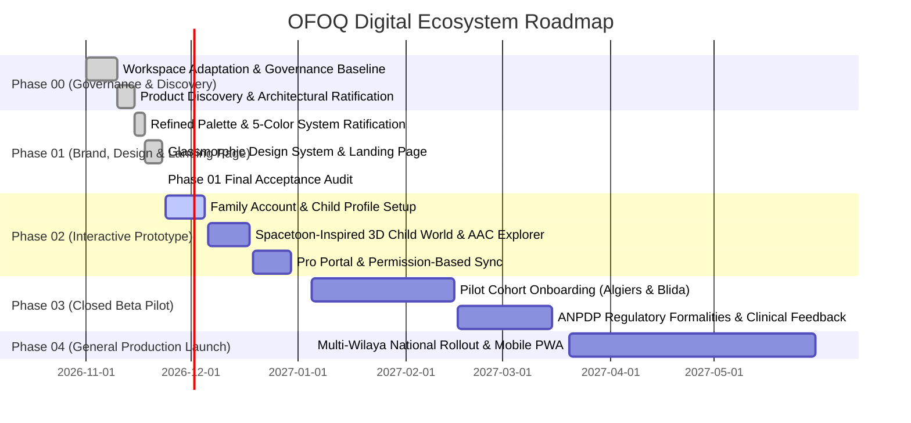

# Master Implementation Plan — OFOQ (أفق)

**Document Identifier:** `DOC-05-PLAN`  
**Version:** 2.0.0 (OFOQ Ecosystem Execution Roadmap)  
**Primary Language:** English  
**Audience:** Founders, Product Management, Engineering Leads, Clinical Advisors, Regulatory Stewards  
**Last Updated:** November 2026  
**Status:** `READY FOR EXECUTION`

---

## 1. Project Management Hierarchy & Governance Rules

The OFOQ master delivery roadmap is organized under a strict, traceable hierarchy:

$$\text{INITIATIVE} \longrightarrow \text{PHASE} \longrightarrow \text{MILESTONE} \longrightarrow \text{TASK} \longrightarrow \text{ACCEPTANCE CRITERIA}$$

### Governance & Approval Gates
No phase advances to the next without formal sign-off at its **Approval Gate**:
- **`NOT STARTED`**: Initial backlog item; awaiting prerequisite phase sign-off.
- **`IN PROGRESS`**: Active development within authorized scope boundaries.
- **`BLOCKED`**: Progress obstructed by external regulatory dependency or open question.
- **`IN REVIEW`**: Deliverable submitted for verification against automated tests and security checklists.
- **`APPROVED`**: Formally validated by Product Owner (PO) and Solution Architect.
- **`DEFERRED`**: Intentionally rescheduled to subsequent development horizon.

### Core Governance Roles
- **[FOUNDER / PO]**: Vision, clinical partnerships, regulatory strategy (ANPDP), parent feedback loops.
- **[SOLUTIONS ARCHITECT / TECH LEAD]**: Cloud architecture, security rules, data isolation, performance, CI/CD.
- **[DESIGN SYSTEMS LEAD]**: UI/UX, design tokens, sensory-friendly glassmorphism, 3D child world metaphors.
- **[CLINICAL ADVISOR]**: Speech-language pathologists (orthophonistes), special educators, AAC/CAA standards.
- **[QA / SEC AUDITOR]**: Data minimization, Law 18-07 privacy audits, WCAG 2.1 accessibility, end-to-end verification.

---

## 2. High-Level Initiative Roadmap (Phases 00–04)

---

## 3. Detailed Phase Breakdown

### Phase 00 — Product Discovery & Workspace Adaptation (`COMPLETED`)
- **Objective:** Establish the foundational OFOQ product baseline, decouple inherited repositories, define exact account boundaries (Admin, Pro, Parent), and author `OFOQ_PROJECT_DISCOVERY.md`.
- **Deliverables:**
  - `docs/00-project/OFOQ_PROJECT_DISCOVERY.md`: Authoritative source of truth.
  - `docs/00-project/decision-log.md`: Decisions DEC-001 through DEC-006.
  - `docs/01-product/product.md`: Product requirements and persona specs.
- **Approval Gate:** Ratified in commit `89c16d2`.

### Phase 01 — Brand Identity, Design System & Public Landing Page (`COMPLETED`)
- **Objective:** Establish the OFOQ brand identity, implement the Refined 5-Color Palette, author the design system, build the multilingual glassmorphic public landing page, and pass the Phase 01 Final Acceptance Audit.
- **Deliverables:**
  - `docs/02-design/design.md`: Master design system with tokens, glassmorphism rules, and Experiences A–E.
  - `web/`: Production-ready single-page application with responsive glassmorphism, 100% i18n parity across Arabic, French, and English, interactive AAC Child World preview, and 46 automated tests passing.
  - Audit Fixes: Commit `6a3d7e4` and state ratification `1e663ea`.
- **Approval Gate:** Accepted with documented limitations (`PHASE_01_ACCEPTED_WITH_DOCUMENTED_LIMITATIONS`).

### Phase 02 — Interactive Prototype (Closed-Loop Family & Child Worlds) (`NEXT`)
- **Objective:** Build the interactive, clickable web prototype demonstrating the core product loop:
  1. Parent creates a Family Account and adds Child Profiles.
  2. Each Child Profile generates a personalized, 3D Spacetoon-inspired Child World (custom theme, pictograms, routine stars, calm sensory settings).
  3. Parent invites an Orthophoniste / Pro to view and assign specific therapy pictograms.
  4. Child enters their World safely with zero passwords and interacts with their customized AAC communication board.
- **Deliverables:**
  - Prototype Views: Parent Dashboard, Child World (Space/Ocean/Nature theme), Specialist Portal, Admin Governance.
  - Usability testing sessions with 5 Algerian families and 3 licensed speech therapists.
- **Approval Gate:** Usability score $\ge 85/100$, zero data leakage across sibling profiles.

### Phase 03 — Closed Beta Pilot (Algiers Cohort)
- **Objective:** Deploy a secure, sandboxed beta environment with real speech therapy private practices and family cohorts across Algiers, Blida, and Boumerdès.
- **Key Milestones:**
  - ANPDP regulatory declaration and filing under Algerian Law 18-07.
  - Dedicated OFOQ Supabase PostgreSQL instance with Row Level Security (RLS) and encrypted audit logs.
  - Real-time speech synthesis (Modern Standard Arabic, French, and Algerian Derja audio library).

### Phase 04 — General Availability & National Rollout
- **Objective:** Open registration across all 58 Algerian wilayas, introduce mobile PWA with offline speech synthesis, and expand specialized center integrations.

---

## 4. Key Performance Indicators (KPIs) & Quality Metrics

1. **Accessibility (WCAG 2.1 AA):** 100% compliance on color contrast, focus rings, keyboard navigability, and sensory calm.
2. **Pediatric Data Sovereignty:** 100% compliance with Law 18-07; zero medical/clinical diagnostic data stored; instant parental consent revocation.
3. **Multilingual Parity:** Continuous 100% key parity across Modern Standard Arabic, French, and English verified by automated CI checks.
4. **Performance:** Sub-2-second Time to Interactive (TTI), Lighthouse Performance score $\ge 90$.
